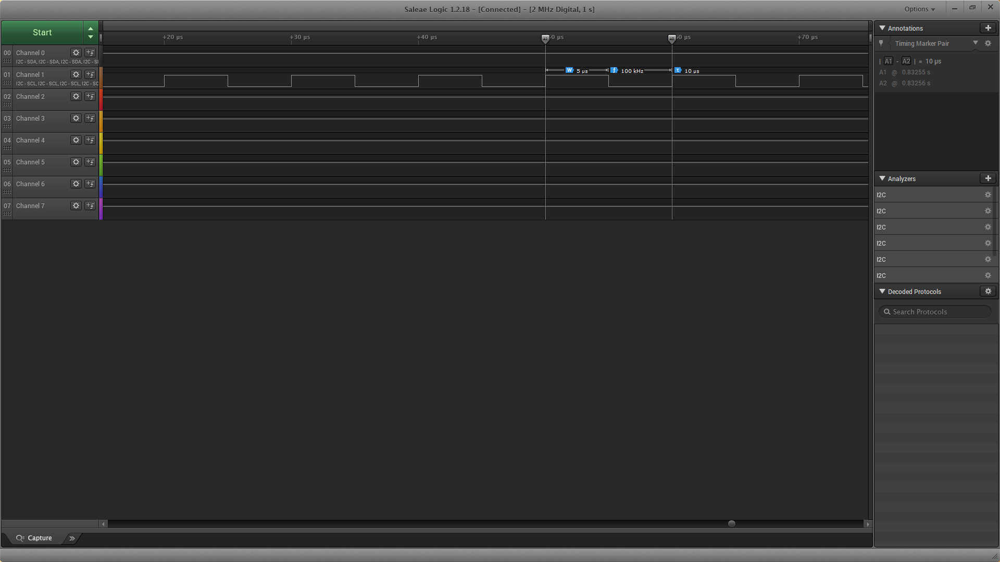
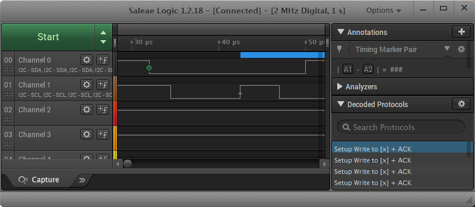

# EnvMonitor — FPGA 多路环境参数监测系统

> 纯硬件逻辑（无软核 CPU）实现的双通道温湿度实时监测系统，基于紫光同创 PGL50H（盘古 50K 开发板）。
> 从零实现 I2C 主机控制器、SSD1306 OLED 驱动、AHT20 传感器驱动三层完整协议栈，共 1001 行 Verilog。


---

## 功能特性

| 功能 | 说明 |
|---|---|
| **双通道并行采集** | 两路物理独立的 I2C 总线，各自挂接一片 AHT20，地址相同（0x38）互不冲突 |
| **实时显示** | 128×64 SSD1306 OLED，4 行显示（标题 / CH1 / CH2 / 状态），100 ms 刷新 |
| **滞回告警** | 30.0 ℃ 触发、29.5 ℃ 解除，避免阈值抖动导致 LED 频繁闪烁 |
| **心跳指示** | LED1 以 1 Hz 闪烁，指示系统正常运行 |
| **零 Block RAM** | 字符缓冲 + 组合逻辑字库替代像素帧缓存，BRAM 占用为 0 |

## 技术指标

| 指标 | 设计值 | 实测值 |
|---|---|---|
| 系统时钟 | 50 MHz | 50 MHz |
| OLED I2C 速率 | 100 kHz | **100 kHz**（逻辑分析仪实测） |
| 传感器 I2C 速率 | 25 kHz | 25 kHz |
| SCL 周期 / 占空比 | 10 µs / 50% | **10.0 µs / 50%** |
| 显示刷新周期 | 100 ms | 约 100 ms |
| 温度 / 湿度分辨率 | 0.1 ℃ / 0.1 %RH | 一致 |
| LUT 占用 | — | 1895 / 42800（4.43%） |
| 寄存器占用 | — | 1707 / 64200（2.66%） |
| Block RAM | — | 0 / 134（0.00%） |
| 时序 | — | 无违例（TNS = 0） |

## 系统架构

```
┌─────────────────────────────────────────────────┐
│              top_env_monitor                    │
│  时基调度(100ms/500ms) │ 告警判断(滞回) │ 字符映射 │
└───────┬─────────────────┬───────────────┬───────┘
        │                 │               │
┌───────▼──────┐  ┌───────▼──────┐  ┌─────▼───────┐
│ oled_ssd1306 │  │ aht20_driver │  │aht20_driver │
│  协议层      │  │    CH1       │  │    CH2      │
└───────┬──────┘  └───────┬──────┘  └─────┬───────┘
┌───────▼──────┐  ┌───────▼──────┐  ┌─────▼───────┐
│  i2c_master  │  │  i2c_master  │  │  i2c_master │
│   100 kHz    │  │    25 kHz    │  │    25 kHz   │
└───────┬──────┘  └───────┬──────┘  └─────┬───────┘
    SSD1306            AHT20             AHT20
     0x3C              0x38              0x38
```

`i2c_master` 为可复用 IP：三路总线共用同一份代码，仅通过 `I2C_FREQ` 参数区分速率。

## 目录结构

```
.
├── rtl/
│   ├── top_env_monitor.v    顶层：时基、字符映射、告警、LED（322 行）
│   ├── oled_ssd1306.v       SSD1306 驱动：初始化、页写、字库（285 行）
│   ├── aht20_driver.v       AHT20 驱动：初始化、触发、读取、换算（182 行）
│   └── i2c_master.v         I2C 主机控制器，可复用 IP（212 行）
├── constraints/
│   └── env_monitor.fdc      引脚约束
├── bitstream/
│   ├── top_env_monitor.sbit 已编译码流
│   └── top_env_monitor.smsk
├── docs/
│   └── 调试记录.md          11 处缺陷的定位与修复记录
├── images/
│   ├── 01_SCL_100kHz_周期10us.png
│   └── 02_I2C_地址0x78_ACK.png
├── build.tcl                一键编译脚本
└── README.md
```

## 引脚分配

| 信号 | FPGA 球号 | J8 引脚 | 说明 |
|---|---|---|---|
| sys_clk | P20 | — | 50 MHz 板载晶振 |
| aht1_sda | Y12 | Pin15 | CH1 传感器数据 |
| aht1_scl | W12 | Pin16 | CH1 传感器时钟 |
| oled_sda | U12 | Pin17 | OLED 数据 |
| oled_scl | T12 | Pin18 | OLED 时钟 |
| aht2_sda | U10 | Pin19 | CH2 传感器数据 |
| aht2_scl | T10 | Pin20 | CH2 传感器时钟 |
| VIN | — | Pin39/40 | A3V3（3.3 V） |
| GND | — | Pin37/38 | 地 |
| led_hb | B2 | — | 心跳指示（1 Hz） |
| led_alarm | A2 | — | 温度超限常亮 |

> 引脚以 `constraints/env_monitor.fdc` 为唯一权威来源。

## 编译与烧录

**环境**：Pango Design Suite 2022.2-SP1-Lite，器件 PGL50H-6FBG484

```bash
cd EnvMonitor
pds_shell.exe -file build.tcl
```

> 工程路径**不可包含中文、空格、括号**，否则 PDS 报 `Flow-0002`。

编译产物由 PDS 生成于 `generate_bitstream/top_env_monitor.sbit`。

## 实测验证

### SCL 时钟频率



逻辑分析仪（2 MS/s）实测：SCL 高电平 5.0 µs、周期 10.0 µs、频率 100 kHz、占空比 50 %，与 `I2C_FREQ = 100_000` 设计值一致。

### I2C 地址与应答



起始条件后 8 个 SCL 周期内 SDA 依次为 `0111 1000`，即地址字节 0x78（0x3C 左移一位 + 写标志）；第 9 个周期从机拉低 SDA 返回 ACK。

## 关键技术点

### 1. 地址字节与数据字节的方向控制必须分离

I2C 读事务中，**地址字节无论读写都必须由主机驱动**，只有数据位才释放 SDA 交由从机输出：

```verilog
if (cur_rw && !is_addr) sda_oe <= 1'b0;        // 仅"读数据位"释放
else                    sda_oe <= ~shifter[7]; // 地址字节、写数据位由主机驱动
```

省略 `!is_addr` 判断会让读事务的地址字节被发成 0xFF，从机不应答，表现为「**写正常、读全错**」——这个不对称性曾导致长达数天的误判（OLED 只写所以正常，传感器必须读所以全错）。

详见 [`docs/调试记录.md`](docs/调试记录.md)。

### 2. 湿度换算必须用 32 位中间量

```verilog
wire [19:0] raw_h = {d1, d2, d3[7:4]};
wire [31:0] h_num = raw_h * 20'd1000;
humi_x10 <= h_num[30:20];
```

若写作 `(raw_h * 11'd1000) >> 20`，Verilog 按左值位宽推导表达式位宽，乘积在 20 位处溢出回绕，结果恒为 0。

### 3. 三态控制集中放在顶层

```verilog
assign aht1_sda   = aht1_sda_oe ? 1'b0 : 1'bz;
assign aht1_sda_i = aht1_sda;   // 回读引脚真实电平
```

子模块只收发 `scl_oe / sda_oe / sda_i` 三个纯信号，不在子模块内部读 inout 端口。

## 已知限制

- 当前为**桌面验证原型**：无外壳、无历史数据存储、无通信接口
- 仅 2 个采集通道，未组网
- 告警阈值与采样周期写死在代码中，现场不可调

## 许可

MIT License
